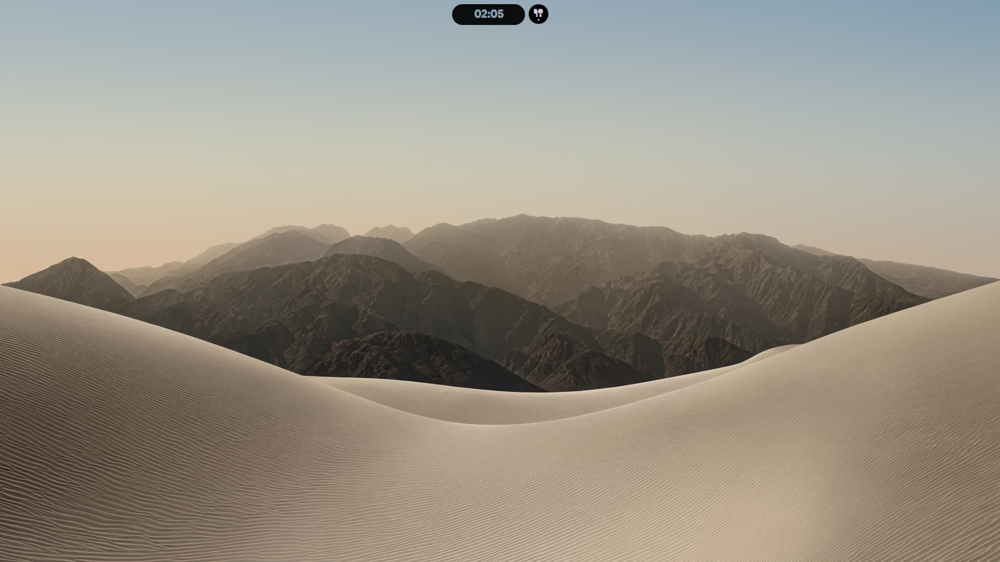

<div align="center">

# Dynamic Island Hyprland

A modular, native desktop shell for Hyprland (Wayland), built with Quickshell (Qt 6) and native C++20.

[](https://hyprland.org/)
[](https://quickshell.org/)
[]()
[](LICENSE)

<br/>



</div>

Dynamic Island Hyprland replaces traditional status bars, lockscreens, notification daemons, and standalone OSDs with an integrated, fluid desktop shell tailored for Hyprland.

---

## Installation

Run the one-line automated installer:

```bash
bash -c "$(curl -fsSL https://raw.githubusercontent.com/St0rmosu/dynamic-island-hyprland/main/install.sh)"
```

> [!NOTE]
> The script automatically installs all required dependencies, compiles the native C++ backend, and configures Hyprland autostart and layer rules in your `hyprland.lua`. To update in the future, simply run the command again.

### Running

To launch or restart the shell manually:

```bash
dynamic-island -d
```

---

## Features

### 1. Dynamic Island
- **Center Capsule**: Adaptive status pill anchored at the top of the display with an animated mechanical flip clock and vector battery contours.
- **Fluid Dropdowns**: Smooth concave transitions extending into active alerts, status menus, and drawers.
- **Satellites**: Floating pills for workspaces, active media sessions, headphones, and incoming calls.
- **Hardware OSD**: Minimalist on-screen indicators for volume, brightness, and power events.

### 2. Apple-Style Lockscreen
- Standalone Wayland lockscreen (`lock/`) with native PAM authentication.
- Fluid media player card with ripple track transitions and spring physics.
- Integrated date, time, and battery complications.

### 3. Workspace Overview
- Interactive exposé view of all active Hyprland workspaces and running windows.
- Full keyboard and mouse navigation to focus or rearrange applications.

### 4. Control Center & Connectivity
- Unified quick settings drawer for network, Bluetooth, audio sinks, and system toggles.
- Dedicated popout drawers for Wi-Fi management and Bluetooth device pairing.

### 5. Notifications & Alerts
- Redesigned desktop notifications with brand icons, sender details, and auto-dismiss progress.
- Status and reload alerts for configuration changes with copyable error logs.

### 6. Productivity & Utilities
- **FocusTime**: Built-in Pomodoro timer with daily application tracking.
- **Screenshot Suite**: Snipping capsule with instant preview card, clipboard integration, and Satty annotation.
- **File Shelf**: Drag-and-drop staging area for temporary files.
- **Clipboard History**: Searchable clipboard history manager.
- **Power Menu**: 5-action session modal (Lock, Logout, Suspend, Reboot, Shutdown).
- **Wallpaper Carousel**: Visual wallpaper picker supporting `awww`.

---

## Customization

- **Dynamic Theming**: Color palettes automatically adapt to your current wallpaper with built-in support for **Pywal**, **Wallust**, **Matugen**, and **Iris** (`wal`).
- **Settings App**: A dedicated visual settings interface allows customizing appearance, behaviors, and layout options directly from the desktop.

---

## License

Distributed under the **MIT License**. See [`LICENSE`](LICENSE) for details.
